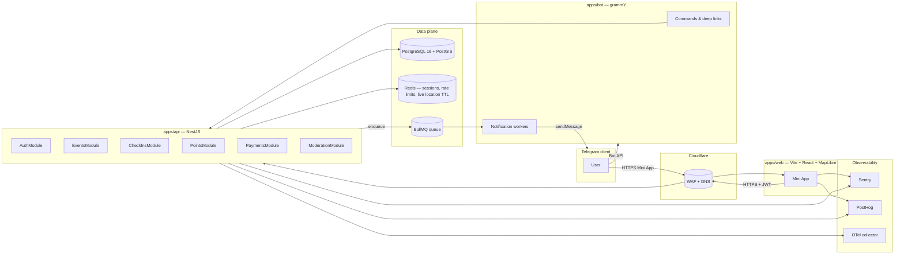

# Architecture — Game is Game

## TL;DR

A Telegram user opens the Mini App from a chat or deep link. The app authenticates to our backend with Telegram's signed `initData`. The backend resolves the user, returns a short-lived JWT, and serves nearby events from PostGIS. Check-ins, points, leaderboards and boosts flow through the same API. A separate bot process handles slash commands and dispatches notifications from a Redis-backed queue.

## System diagram

## Critical flows

### 1. Auth (Mini App → API)

1. Mini App reads `Telegram.WebApp.initData`.
2. `POST /auth/telegram { initData }`.
3. API validates HMAC-SHA256 with bot token, checks `auth_date` freshness, upserts `User`, issues access JWT (15 min) + refresh token stored in Redis.
4. Future requests carry `Authorization: Bearer <jwt>`.

### 2. Nearby discovery

1. Mini App posts viewport center + radius.
2. `EventsModule` runs `ST_DWithin` on `GameEvent.geo_point`.
3. `RankingService` blends distance, recency, friend overlap, community match, hot_score, and boost_score (capped) into a final rank.
4. Response is paginated; map markers cluster client-side at low zoom.

### 3. Check-in

1. Mini App posts `{lat, lng, accuracy, method}` to `POST /events/:id/checkin`.
2. Guard chain in `CheckInsModule`: auth → event active → participant → time window → cooldown → daily limit → distance → accuracy → speed → new-account penalty → reports penalty → method handler.
3. Each guard contributes to `fraud_score`. ≥70 = reject (silent). 40–69 = pending. <40 = confirmed, ledger entry written, BullMQ notification enqueued.

### 4. Boost purchase (Telegram Stars)

1. Host taps "Boost" → `POST /events/:id/boost { plan }`.
2. API creates a pending `Boost` row, calls Bot API `createInvoiceLink` with `XTR`, returns the link.
3. Mini App opens it via `window.Telegram.WebApp.openInvoice`.
4. Bot receives `pre_checkout_query` → validates pending Boost → answers `ok: true`.
5. Bot receives `successful_payment` → idempotently activates the Boost.

### 5. Notifications

1. API enqueues a typed job onto BullMQ (`event_starting_soon`, `friend_joined_event`, …).
2. Bot worker pops the job, checks per-user rate cap (max 5/day), formats the message with a deep link, calls Bot API `sendMessage`.

## Layering rules

- `packages/shared` is a dependency of `apps/web`, `apps/api`, `apps/bot`. It depends on no app.
- `apps/bot` never writes to PostgreSQL directly except via service-to-service HTTP calls to `apps/api`.
- `apps/web` never calls the Telegram Bot API directly. Everything goes through `apps/api`.
- Cross-cutting concerns (auth, rate limits, audit log) are NestJS guards/interceptors — never inlined in controllers.

## Where to find more

- [`docs/PHASES/`](./PHASES/) — phased implementation plan (this document set).
- `docs/API.md` — endpoint reference (written in phase 3).
- `docs/SECURITY.md` — threat model and hardening checklist (phase 10).
- `docs/PRIVACY.md` — data minimization, retention, GDPR endpoints (phase 10).
- `docs/FRAUD_DETECTION.md` — check-in fraud pipeline and weights (phase 4).
- `docs/POINTS_ECONOMY.md` — points awarded per action (phase 5).
- `docs/PAYMENTS.md` — Telegram Stars boost flow (phase 8).
- `docs/RUNBOOK.md` — on-call procedures (phase 11).
