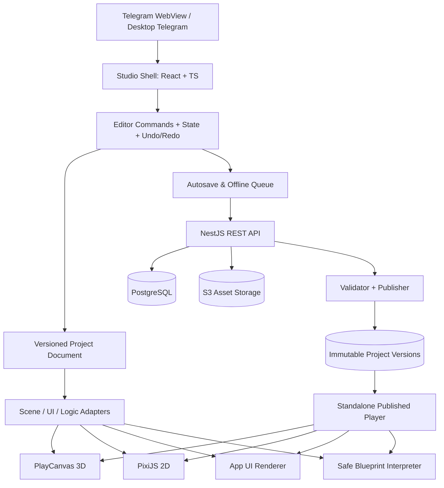

# 03. Архитектура редактора, движка и исполнения

## 1. Основной принцип

**Project Document — единственный источник истины** для сохраняемых данных проекта. Scene, UI, graphs и assets лежат в версионируемой типизированной схеме. Ни PlayCanvas, ни PixiJS, ни React-компоненты не хранятся в базе как opaque engine state. Render adapters проецируют Project Document в конкретный runtime. Любое действие редактирования оформляется EditorCommand и влияет на документ; пользовательский UI — лишь способ создать команду.

## 2. Схема подсистем



## 3. Монорепозиторий

```text
tg-creator-studio/
  apps/
    studio/              # авторизация, dashboard, редактор, Preview shell
    player/              # публичный runtime без editor-компонентов и привилегий
    api/                 # NestJS API / DB / publish / data collections
    worker/              # thumbnails, asset conversion, publish validation
  packages/
    project-schema/      # ProjectDocument, migrations, Zod schema
    editor-core/         # command bus, selection, history, serialization
    engine-3d/           # PlayCanvas scene adapter + gizmos + asset loaders
    engine-2d/           # PixiJS scene adapter + input + collision bridge
    app-runtime/         # allowlisted UI widgets + declarative action runtime
    logic-engine/        # node registry, typing, verifier, interpreter
    physics/             # Rapier2D/3D adapters and lifecycle
    telegram/            # bridge, themes, viewport, feature detection
    asset-sdk/           # asset manifests, signed upload, resource resolving
    ui-kit/              # общий дизайн-системный набор
    shared/              # errors, types, util
  docs/                   # этот пакет
  prompts/                # этот пакет
  .cursor/rules/
  docker-compose.yml
  pnpm-workspace.yaml
  turbo.json
```

Зависимости идут от приложений к packages, **не наоборот**. `editor-core` не импортирует PlayCanvas/Pixi; `project-schema` не импортирует React. Player **не импортирует** editor-core и admin API; он выполняет только подписанный/валидированный опубликованный manifest.

## 4. Модель данных (нормативный набросок)

```ts
type ProjectType = 'game3d' | 'game2d' | 'app';
type ComponentType =
  | 'transform'
  | 'mesh'
  | 'material'
  | 'camera'
  | 'light'
  | 'rigidBody3d'
  | 'collider3d'
  | 'sprite'
  | 'collider2d'
  | 'audio'
  | 'playerController'
  | 'scriptGraph';

interface ProjectDocument {
  schemaVersion: 1;
  id: string;
  ownerId: string;
  title: string;
  type: ProjectType;
  settings: {
    orientation: 'auto' | 'portrait' | 'landscape';
    quality: 'auto' | 'low' | 'medium' | 'high';
  };
  entrySceneId?: string;
  scenes: Scene[];
  pages: AppPage[];
  graphs: LogicGraph[];
  assetRefs: AssetRef[];
  globalVariables: Record<string, TypedValue>;
}
interface Scene {
  id: string;
  name: string;
  rootEntityIds: string[];
  entities: Record<string, SceneEntity>;
}
interface SceneEntity {
  id: string;
  name: string;
  parentId: string | null;
  childIds: string[];
  enabled: boolean;
  components: ComponentRecord[];
}
interface ComponentRecord {
  id: string;
  type: ComponentType;
  enabled: boolean;
  data: unknown;
}
interface LogicGraph {
  id: string;
  nodes: LogicNode[];
  edges: LogicEdge[];
}
interface AppPage {
  id: string;
  route: string;
  rootComponentId: string;
  components: Record<string, AppComponent>;
}
interface AssetRef {
  id: string;
  version: string;
  kind: 'model' | 'image' | 'audio' | 'font';
}
interface TypedValue {
  type: 'string' | 'number' | 'boolean' | 'vec2' | 'vec3';
  value: unknown;
}
```

Реализация использует **discriminated unions + Zod** для каждого компонента и typed node. Не оставляйте `unknown` без последующей проверки. Любые `parentId`, `childIds`, `rootEntityIds` обязаны пройти проверку отсутствия циклов и битых ссылок. `schemaVersion` мигрирует `v1 → v2` через отдельные чистые функции с тестами на сохранение смысла.

**Стабильные IDs**: UUID/ULID генерируются при создании сущности. ID не должен меняться при сохранении, рендере, переподключении или редактировании свойства. 3D-world coordinates в метрах, правосторонняя система координат по правилам выбранного engine adapter; единицы и конверсия документированы.

## 5. Поток изменения сцены

1. UI вызывает `dispatch(editorCommand)`; `command.validate(snapshot)` проверяет типы и права UI.
2. `editor-core` применяет чистую операцию к документу, сохраняет inverse для Undo/Redo.
3. Изменение помечает документ `dirty`, увеличивает **локальную** ревизию и создает patch.
4. Scene adapter получает diff/patch, обновляет объект(ы) в PlayCanvas/PixiJS без полного перестроения.
5. Autosave дебаунсит команды (например, 800–1500 мс, настраиваемо), отправляет `{baseRevision, patch, mutationId}`.
6. Backend проверяет разрешения, версии и schema, атомарно записывает обновленный snapshot/patch, возвращает `revision`, `etag`, server time.
7. Client показывает `Saved` **только** после успешного ответа. При 409 Conflict — интерфейс merge/reload/copy; при offline — локальный IndexedDB queue, который не называется облачным сохранением.

На R0 можно передавать целый документ с `If-Match/revision`; patch-протокол вводить после профилирования. Никакой ложной многопользовательской синхронизации до Yjs.

## 6. Edit / Play / Published Runtime

```text
Editable ProjectDocument
   ├── Edit Adapter: gizmos, selection, inspector, editor camera
   └── Play Snapshot (deep clone / immutable): no editing commands
        ├── Scene Adapter (3D or 2D) / App Runtime
        ├── Blueprint Interpreter
        ├── Physics Step (fixed timestep, e.g. 1/60; accumulator/cap)
        └── Debug output + profiling

Server Publish validated snapshot → immutable ProjectVersion
   └── Player loads ProjectVersion + approved assets, no draft API access
```

**Runtime lifecycle**: `initialize → load assets → instantiate scene → start → update/fixedUpdate → pause/resume → stop → dispose`. На каждом stop очищать event listeners, physics bodies, WebGL resources, timers, audio nodes. Разделять editor camera и game camera. Play changes не влияют на Draft. Для сохранения игровой прогресс авторизованного игрока — отдельный Store/DataCollections с ограничениями, не ProjectDocument.

### Game systems и backend-neutral adapter

- Rendering 3D: PlayCanvas; GLB loader, materials, camera/light, animation.
- Physics 3D: Rapier3D через adapter. PlayCanvas имеет интеграцию с Ammo.js; не подключать оба physics engine одновременно к одним и тем же объектам. При выборе Rapier создайте и протестируйте явный bridge pose/sync.
- Rendering 2D: PixiJS, sprites, layers, tilemaps.
- Physics 2D: Rapier2D отдельным adapter.
- App UI: React allowlist renderer, no user JSX execution.
- Events: единая EventBus модель для graph events; scope scene/session, limits per tick.
- Asset resolution: media IDs → versioned signed/public resource URLs; no raw HTML from user.

## 7. Blueprint interpreter — исполняемая система, а не диаграмма

**Validator:** проверка направления портов, типов, обязательных входов, ссылаемых entity/variable IDs, доступности node type, отсутствия бесконечных синхронных циклов. Узел `Delay` дает явную async boundary. Каждый trigger создает event envelope с `sceneId`, `entityId`, `timestamp`, `args`.

**Compiler:** сериализованный React Flow graph преобразуется в версионированный `ValidatedGraphIR` (типизированная декларативная структура), без генерации JS. **Interpreter:** очередь событий + ограниченное число node evaluations за frame, max recursion depth, max loops, max outstanding timers, global pause/stop; дебаггер логирует `graphId/nodeId` и понятное сообщение. У каждого node registry есть `defineInputs`, `defineOutputs`, `validate`, `execute(context)`, `requiredCapabilities`.

Для серверных действий (например Data.Create): `Graph Interpreter → permitted client action dispatcher → authenticated API → permission/limit checks → database`; никакие токены не встроены в граф. Отдельная модель разрешений для автора и игрока.

## 8. Telegram bridge

Сервер принимает **сырую строку** `Telegram.WebApp.initData`, проверяет подпись Telegram, `auth_date`, срок действия, связывает id с внутренним пользователем, выдает краткоживущую session cookie или access token по безопасной схеме. `initDataUnsafe` нельзя использовать для установления прав.

`WebApp.ready()` после инициализации; `expand()` где доступно; optional `requestFullscreen()` только с проверкой метода и версии API, корректная работа без fullscreen; `viewportStableHeight`, `safeAreaInset`, `contentSafeAreaInset`, события theme/viewport/back; close confirmation при `dirty` и выходе. Учитывать, что встроенный webview на ПК и смартфоне имеет разный доступный размер. Публичный Player — отдельный route той же Mini App, определяемый по безопасному startapp id.

**Deep link:** `https://t.me/<bot>?startapp=p_<publicId>`; параметр — маршрутизация, не аутентификация. У бота должен быть корректно настроен Main Mini App/соответствующий способ запуска. HTTPS обязателен для web app.

## 9. API, RBAC и защита

- API auth + CSRF/CORS policy (в зависимости от сессионной схемы), project owner ACL, constraints по quota.
- Draft private by default; опубликованные версии доступны по выбранным правилам visibility. Data Collections — собственная доменная ACL с проверкой каждой операции.
- Размер/формат/содержимое asset валидируются, превью обрабатываются worker; не доверять `Content-Type`.
- Player на **отдельном origin** рекомендуется для изоляции и CSP; sandbox для пользовательского контента, запрет произвольного JS. Если нужен iframe, заранее проверить разрешения Telegram и cross-origin ограничения.
- CSP, Trusted Types при поддержке, escaping, no `eval`, sanitization URI, no arbitrary iframe/script injection.
- External API Connectors — через capability proxy: allowlist origins/actions, timeouts, egress controls, SSRF protections, secrets server-only.
- WebSocket permissions checked on connect **and** on room actions; выдача приватных данных строго по владельцу и правилу доступа.
- Rate limits per user/project/public player, storage quota, CPU/frame resource budgets, audit logs.

## 10. Работа нескольких устройств и совместная разработка

R0/R1: один пользователь может открыть проект на нескольких устройствах, но конкурентное редактирование не разрешается «молчаливым last-write-wins». Optimistic revision + HTTP 409 Conflict + UI diff/copy. Позже R2 — CRDT Yjs с присутствием пользователей, revision snapshot checkpoints, awareness cursors и правами для команд; корректные merge-стратегии для scene graph, reparent и atomic rename важнее простого подключения Yjs.

## 11. Схема развёртывания

```text
Telegram client -> HTTPS CDN
  /studio   -> static SPA editor
  /play     -> static Player runtime
  /api      -> NestJS (stateless)
                  ├─ PostgreSQL (users, projects, versions, collections)
                  ├─ Redis (sessions, rate limits, jobs) [по необходимости]
                  ├─ S3 (assets, thumbnails, immutable manifests)
                  └─ Worker queue (previews, validation)
```

Обязательны: dev/staging/prod environments, TLS, DB migrations, error reporting, request ID, S3 lifecycle, backup, restore drills, staging Telegram bot, protected secrets, dependency/license audit.
