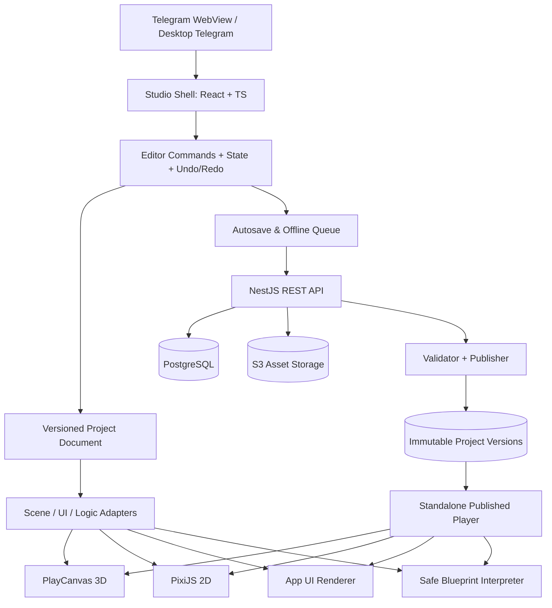

# 03. Архитектура редактора, движка и исполнения

## 1. Основной принцип

**Project Document — единственный источник истины** для сохраняемых данных проекта. Scene, UI, graphs и assets лежат в версионируемой типизированной схеме. Ни PlayCanvas, ни PixiJS, ни React-компоненты не хранятся в базе как opaque engine state. Render adapters проецируют Project Document в конкретный runtime. Любое действие редактирования оформляется EditorCommand и влияет на документ; пользовательский UI — лишь способ создать команду.

## 2. Схема подсистем



## 3. Монорепозиторий

```text
tg-creator-studio/
  apps/
    studio/              # авторизация, dashboard, редактор, Preview shell
    player/              # публичный runtime без editor-компонентов и привилегий
    api/                 # NestJS API / DB / publish / data collections
    worker/              # thumbnails, asset conversion, publish validation
  packages/
    project-schema/      # ProjectDocument, migrations, Zod schema
    editor-core/         # command bus, selection, history, serialization
    engine-3d/           # PlayCanvas scene adapter + gizmos + asset loaders
    engine-2d/           # PixiJS scene adapter + input + collision bridge
    app-runtime/         # allowlisted UI widgets + declarative action runtime
    logic-engine/        # node registry, typing, verifier, interpreter
    physics/             # Rapier2D/3D adapters and lifecycle
    telegram/            # bridge, themes, viewport, feature detection
    asset-sdk/           # asset manifests, signed upload, resource resolving
    ui-kit/              # общий дизайн-системный набор
    shared/              # errors, types, util
  docs/                   # этот пакет
  prompts/                # этот пакет
  .cursor/rules/
  docker-compose.yml
  pnpm-workspace.yaml
  turbo.json
```

Зависимости идут от приложений к packages, **не наоборот**. `editor-core` не импортирует PlayCanvas/Pixi; `project-schema` не импортирует React. Player **не импортирует** editor-core и admin API; он выполняет только подписанный/валидированный опубликованный manifest.

## 4. Модель данных (schemaVersion 2)

Нормативный источник — Zod-схемы `packages/project-schema/src/v2.ts`; ниже их форма. Все объекты строгие (`.strict()`): неизвестное поле — ошибка, а не молча отброшенный ключ. `data` компонента, props виджета и `TypedValue` — discriminated unions, `unknown` в документе не остаётся.

```ts
type ProjectType = 'game3d' | 'game2d' | 'app';
type Id = string; // /^[A-Za-z0-9_-]+$/, ≤ 64; ID сущностей уникальны во всём документе

interface ProjectDocument {
  schemaVersion: 2;
  id: string; // = projects.id (UUID), ≤ 64
  ownerId: string; // = users.id, ≤ 64
  title: string; // trim, 1–120
  type: ProjectType;
  settings: {
    orientation: 'auto' | 'portrait' | 'landscape';
    quality: 'auto' | 'low' | 'medium' | 'high';
  };
  entrySceneId: Id | null; // обязателен для game*, null для app без сцен
  scenes: Scene[];
  pages: AppPage[]; // app: ≥ 1 страница
  graphs: LogicGraph[];
  assetRefs: AssetRef[];
  globalVariables: Record<string, TypedValue>;
}
interface Scene {
  id: Id;
  name: string;
  rootEntityIds: Id[];
  entities: Record<Id, SceneEntity>;
} // ≤ 5000 entities
interface SceneEntity {
  id: Id;
  name: string;
  parentId: Id | null;
  childIds: Id[];
  enabled: boolean;
  components: ComponentRecord[]; // ≤ 32, не более одного компонента каждого type
}
type ComponentRecord = { id: Id; enabled: boolean } & (
  | { type: 'transform'; data: { position: Vec3; rotationEuler: Vec3; scale: Vec3 } }
  | {
      type: 'mesh';
      data: {
        primitive: 'box' | 'sphere' | 'plane' | 'cylinder' | 'capsule' | 'cone';
        assetId: Id | null;
      };
    }
  | {
      type: 'material';
      data: {
        baseColor: Hex;
        roughness: number;
        metalness: number;
        emissive: Hex;
        opacity: number;
      };
    }
  | {
      type: 'camera';
      data:
        | { projection: 'perspective'; fov: number; nearClip: number; farClip: number }
        | { projection: 'orthographic'; orthoHeight: number; nearClip: number; farClip: number };
    } // farClip > nearClip
  | {
      type: 'light';
      data: {
        kind: 'directional' | 'point' | 'spot';
        color: Hex;
        intensity: number;
        range: number;
        castShadows: boolean;
      };
    }
  | {
      type: 'rigidBody3d';
      data: {
        bodyType: 'dynamic' | 'kinematic' | 'static';
        mass: number;
        linearDamping: number;
        angularDamping: number;
        gravityScale: number;
      };
    }
  | {
      type: 'collider3d';
      data: { shape: 'box' | 'sphere' | 'capsule'; size: Vec3; isTrigger: boolean };
    }
  | {
      type: 'sprite';
      data: {
        assetId: Id | null;
        color: Hex;
        layer: number;
        sortOrder: number;
        flipX: boolean;
        flipY: boolean;
      };
    }
  | {
      type: 'collider2d';
      data: { shape: 'box' | 'circle'; size: Vec2; isStatic: boolean; isTrigger: boolean };
    }
  | {
      type: 'audio';
      data: {
        assetId: Id | null;
        volume: number;
        loop: boolean;
        autoplay: boolean;
        spatial: boolean;
      };
    }
  | {
      type: 'playerController';
      data: {
        mode: 'firstPerson' | 'thirdPerson' | 'platformer2d';
        moveSpeed: number;
        jumpHeight: number;
      };
    }
  | { type: 'scriptGraph'; data: { graphId: Id } }
);
interface AppPage {
  id: Id;
  name: string;
  route: string /* /^\/[a-z0-9\-/]*$/ */;
  rootComponentId: Id;
  components: Record<Id, AppComponent>;
}
type AppComponent = { id: Id; childIds: Id[] } & (
  | { type: 'container'; props: { direction: 'column' | 'row'; gap: number; padding: number } }
  | { type: 'text'; props: { text: string; variant: 'title' | 'subtitle' | 'body' | 'caption' } }
  | {
      type: 'button';
      props: {
        label: string;
        variant: 'primary' | 'secondary';
        action: { kind: 'none' } | { kind: 'navigate'; pageId: Id };
      };
    }
  | { type: 'image'; props: { assetId: Id | null; alt: string; fit: 'cover' | 'contain' } }
  | { type: 'input'; props: { label: string; placeholder: string; fieldKey: string } }
);
interface LogicGraph {
  id: Id;
  name: string;
  nodes: LogicNode[];
  edges: LogicEdge[];
}
interface LogicNode {
  id: Id;
  type: string /* 'group.name' */;
  position: { x: number; y: number };
  data: Record<string, Json>;
}
interface LogicEdge {
  id: Id;
  sourceNodeId: Id;
  sourcePort: string;
  targetNodeId: Id;
  targetPort: string;
}
interface AssetRef {
  id: Id;
  version: string;
  kind: 'model' | 'image' | 'audio' | 'font';
}
type TypedValue =
  | { type: 'string'; value: string }
  | { type: 'number'; value: number }
  | { type: 'boolean'; value: boolean }
  | { type: 'vec2'; value: Vec2 }
  | { type: 'vec3'; value: Vec3 };
```

Точные диапазоны чисел и перечисления — в `v2.ts`; при расхождении с этим наброском прав код, а набросок исправляется в том же PR.

**Целостность** (`validateProjectDocument`, после Zod): ключи записей равны `id`; ID уникальны во всём документе; `parentId`/`childIds`/`rootEntityIds` согласованы и без циклов; ссылки на сцену, страницу, граф, узлы и assets существуют и подходят по `kind` (mesh→model, sprite/image→image, audio→audio); маршруты страниц уникальны, корень страницы — container, у листовых виджетов нет детей, у виджета один родитель. Ошибка структуры → `HIERARCHY_CYCLE` (циклы), `GRAPH_BROKEN_REF` (битые ссылки) или `SCHEMA_INVALID` (остальное), именно в этом приоритете.

**Миграции.** Единственная точка входа — `parseProjectDocument(input)`: `migrateToLatest` → Zod v2 → целостность. Цепочка `v1 → v2` — чистая функция (`migrate.ts`), покрытая golden-фикстурами `packages/project-schema/fixtures/`: она заполняет типизированные `data`/`props` значениями по умолчанию, добавляет `name` страницам и графам и `position` узлам и выставляет `entrySceneId`. Схема v1 заморожена (`v1.ts`) и используется только миграцией. Документ новее поддерживаемой версии или невалидный старый документ → `MIGRATION_FAILED`. Сервер мигрирует сохранённый документ при чтении (`GET draft`), а в БД v2 попадает при следующем `PUT draft`. В БД и в API хранится только этот JSON — объекты движка (Three/Pixi, физика) не сериализуются никогда.

**Стабильные IDs**: UUID/ULID генерируются при создании сущности. ID не должен меняться при сохранении, рендере, переподключении или редактировании свойства. 3D-world coordinates в метрах, правосторонняя система координат по правилам выбранного engine adapter; единицы и конверсия документированы.

## 5. Поток изменения сцены

1. UI вызывает `dispatch(editorCommand)`; `command.validate(snapshot)` проверяет типы и права UI.
2. `editor-core` применяет чистую операцию к документу, сохраняет inverse для Undo/Redo.
3. Изменение помечает документ `dirty`, увеличивает **локальную** ревизию и создает patch.
4. Scene adapter получает diff/patch, обновляет объект(ы) в PlayCanvas/PixiJS без полного перестроения.
5. Autosave дебаунсит команды (например, 800–1500 мс, настраиваемо), отправляет `{baseRevision, patch, mutationId}`.
6. Backend проверяет разрешения, версии и schema, атомарно записывает обновленный snapshot/patch, возвращает `revision`, `etag`, server time.
7. Client показывает `Saved` **только** после успешного ответа. При 409 Conflict — интерфейс merge/reload/copy; при offline — локальный IndexedDB queue, который не называется облачным сохранением.

На R0 можно передавать целый документ с `If-Match/revision`; patch-протокол вводить после профилирования. Никакой ложной многопользовательской синхронизации до Yjs.

### 5.1. Реализация `editor-core` (G3)

- **Команды** — сериализуемый union `EditorCommand`: `entity.insert` (поддерево в pre-order), `entity.remove`, `entity.rename`, `entity.setEnabled`, `entity.move` (`parentId` + `index`, индекс считается после изъятия узла), `component.add`, `component.remove`, `component.update` (`data` + `enabled`). Создание, дублирование, перенос, вложение/вынос и изменение Transform выражаются через них (фабрики `createEntityCommand`, `duplicateEntityCommand`, `setTransformCommand` и т. д.).
- **`applyCommand(doc, cmd)`** — чистая функция: исходный документ не мутируется (структурное разделение, проверяется на deep-frozen документах), результат — `{ ok, document, inverse }` либо `{ ok: false, error }`. `inverse` — точная обратная команда; Undo = применение inverse, Redo = исходной команды.
- **Валидация**: `data` компонента проверяется `componentRecordSchema` из `@tg-creator/project-schema`, после каждой команды — полный `validateProjectDocument`; нарушение целостности отклоняет команду (`INTEGRITY`), документ не меняется. Коды ошибок команд (`ENTITY_NOT_FOUND`, `REPARENT_CYCLE`, `COMPONENT_REQUIRED`, …) — внутренние для клиента, в API не уходят и в docs/06 не входят.
- **История**: стек `past/future` (лимит 200 шагов), группировка по `mergeKey` (drag в viewport = один шаг Undo), монотонная локальная `version`; `dirty = version ≠ savedVersion`, поэтому Undo до сохранённого состояния снова даёт «Сохранено».
- **Сохранение**: `beginSave()` выдаёт тикет `{version, baseRevision, mutationId, document}`; повтор той же версии переиспользует `mutationId` (идемпотентность G2). `saveSucceeded` обновляет `serverRevision`; 409 переводит сессию в `conflict` — дальнейшие сохранения блокируются до явного выбора «Загрузить версию с сервера» или «Сохранить мою как копию». Автосейв и IndexedDB-очередь — G5.
- **Selection** хранит ID и очищается от удалённых сущностей после каждой команды/Undo.
- **Transform**: углы в градусах, порядок `R = Rz·Ry·Rx`, `World = Parent · T · R · S` (соглашение PlayCanvas). `worldDeltaToLocal` переводит перемещение мыши/пальца в локальные координаты родителя.
- **Viewport до G4**: Studio рисует SVG-схему по данным документа (3D — вид сверху X/Z, 2D — X/Y). Это не рендер движка и так подписано в UI; реальный canvas PlayCanvas/PixiJS подключается в G4 к тем же командам. После G4 схема остаётся для 2D-проектов (до G8) и как запасной вид без WebGL2.
- **Новые команды (G4)**: `asset.add` / `asset.remove` (ссылки `assetRefs`, inverse — вставка на прежний индекс) и `batch` — атомарная последовательность шагов, inverse = обратные шаги в обратном порядке; ошибка любого шага отклоняет весь batch. Назначение модели (`setMeshModelCommand`) и «Добавить модель» (`createModelEntityCommand`) — один batch, то есть один шаг Undo.

### 5.2. 3D scene adapter (`@tg-creator/engine-3d`, G4)

- **Интерфейс адаптера** — `createScene(options) → SceneViewport` с `applyChanges(document, sceneId)`, `select(ids)`, `setTool`, `setSnap`, `setViewMode`, `focus`, `dispose`. Studio импортирует пакет динамически: PlayCanvas (~660 КБ gzip) грузится только при открытии 3D-редактора.
- **Синхронизация** — движко-независимый `SceneSync` сравнивает сцену с предыдущей по ссылкам (документ структурно разделяемый, поэтому неизменённые сущности/компоненты — те же объекты) и вызывает `SceneBackend`: `createNode/removeNode/setParent/setName/setEnabled/setTransform/setMesh/setLight/setCamera`. Создание в pre-order, удаление детей раньше родителей, выключенный компонент = `null`. Unit-тесты на fake backend: правка одного поля трогает один setter; случайные последовательности команд дают то же состояние, что полная пересборка; Undo возвращает движок в исходное состояние.
- **JSON — единственный источник истины.** PlayCanvas-сущности пишет только `PlayCanvasBackend` из `SceneSync`. Gizmo (`TranslateGizmo` / `RotateGizmo` / `ScaleGizmo`) прикреплён к прокси-сущности, а не к объекту сцены: `transform:start/move/end` → событие `onTransform` с патчем одного поля → Studio строит `setTransformCommand` с `mergeKey` жеста (весь drag = один шаг Undo, `closeMergeGroup` на отпускании) → новый документ → `applyChanges`. Округление: позиция/масштаб 0,001, углы 0,01°; привязка 0,5 м / 15° / 0,1.
- **Ввод**: gizmo слушает canvas и останавливает событие при попадании в ручку; камера слушает родительский элемент. Пока идёт жест камеры, второй палец перехватывается в capture-фазе и никогда не попадает в gizmo (конфликт orbit/touch). Один палец / ЛКМ — orbit, ПКМ/СКМ/Shift — pan, колесо — zoom, два пальца — pinch-zoom + pan. Tap slop: 4 px мышь, 10 px касание; tap без движения — raycast-выделение (OBB мешей, для света/камер/пустых — радиус 16/26 px на экране).
- **Editor camera ≠ game camera.** Орбитальная камера редактора хранится локально (`tgc.editor.camera.<projectId>`), в документ не попадает. Камеры сцены создаются выключенными; «Камера игры» рендерит через первую включённую камеру документа, скрывает gizmo/сетку/маркеры и отключает жесты. Слой «Editor» (сетка, рамка выделения, маркеры света/камер) исключён из игровых камер.
- **Рендер по требованию**: `autoRender = false`, кадр рисуется после изменения документа, движения камеры, gizmo или resize. ACES tone mapping, sRGB. Если в сцене нет включённого света, редактор добавляет «фару» (только вид редактора, не в игре); ambient 0,32.
- **Модели**: `mesh.assetId` указывает на `AssetRef` вида `model`; байты GLB даёт `loadModel(assetId)`. Пока модель грузится или если загрузка не удалась, виден примитив `mesh.primitive` и выводится предупреждение. Модели используют свои материалы из файла (компонент Material влияет только на примитив).
- **Встроенные модели** (`@tg-creator/asset-sdk`): ID с префиксом `builtin_` (`builtin_tree`, `builtin_rock`, `builtin_crate`, `builtin_house`, `builtin_coin`), версия `1`. GLB генерируется кодом (бинарников в репозитории нет) и проходит через настоящий glTF-загрузчик PlayCanvas; это фикстуры до загрузки ассетов (G5).
- **dispose** снимает все обработчики, ResizeObserver, Blob URL, материалы и вызывает `app.destroy()` (gizmo и слои освобождаются движком).
- WebGL2 обязателен; без него (или при ошибке запуска) Studio показывает схему с пометкой «WebGL2 недоступен — показана схема».

## 6. Edit / Play / Published Runtime

```text
Editable ProjectDocument
   ├── Edit Adapter: gizmos, selection, inspector, editor camera
   └── Play Snapshot (deep clone / immutable): no editing commands
        ├── Scene Adapter (3D or 2D) / App Runtime
        ├── Blueprint Interpreter
        ├── Physics Step (fixed timestep, e.g. 1/60; accumulator/cap)
        └── Debug output + profiling

Server Publish validated snapshot → immutable ProjectVersion
   └── Player loads ProjectVersion + approved assets, no draft API access
```

**Runtime lifecycle**: `initialize → load assets → instantiate scene → start → update/fixedUpdate → pause/resume → stop → dispose`. На каждом stop очищать event listeners, physics bodies, WebGL resources, timers, audio nodes. Разделять editor camera и game camera. Play changes не влияют на Draft. Для сохранения игровой прогресс авторизованного игрока — отдельный Store/DataCollections с ограничениями, не ProjectDocument.

### Game systems и backend-neutral adapter

- Rendering 3D: PlayCanvas; GLB loader, materials, camera/light, animation.
- Physics 3D: Rapier3D через adapter. PlayCanvas имеет интеграцию с Ammo.js; не подключать оба physics engine одновременно к одним и тем же объектам. При выборе Rapier создайте и протестируйте явный bridge pose/sync.
- Rendering 2D: PixiJS, sprites, layers, tilemaps.
- Physics 2D: Rapier2D отдельным adapter.
- App UI: React allowlist renderer, no user JSX execution.
- Events: единая EventBus модель для graph events; scope scene/session, limits per tick.
- Asset resolution: media IDs → versioned signed/public resource URLs; no raw HTML from user.

## 7. Blueprint interpreter — исполняемая система, а не диаграмма

**Validator:** проверка направления портов, типов, обязательных входов, ссылаемых entity/variable IDs, доступности node type, отсутствия бесконечных синхронных циклов. Узел `Delay` дает явную async boundary. Каждый trigger создает event envelope с `sceneId`, `entityId`, `timestamp`, `args`.

**Compiler:** сериализованный React Flow graph преобразуется в версионированный `ValidatedGraphIR` (типизированная декларативная структура), без генерации JS. **Interpreter:** очередь событий + ограниченное число node evaluations за frame, max recursion depth, max loops, max outstanding timers, global pause/stop; дебаггер логирует `graphId/nodeId` и понятное сообщение. У каждого node registry есть `defineInputs`, `defineOutputs`, `validate`, `execute(context)`, `requiredCapabilities`.

Для серверных действий (например Data.Create): `Graph Interpreter → permitted client action dispatcher → authenticated API → permission/limit checks → database`; никакие токены не встроены в граф. Отдельная модель разрешений для автора и игрока.

## 8. Telegram bridge

Сервер принимает **сырую строку** `Telegram.WebApp.initData`, проверяет подпись Telegram, `auth_date`, срок действия, связывает id с внутренним пользователем, выдает краткоживущую session cookie или access token по безопасной схеме. `initDataUnsafe` нельзя использовать для установления прав.

`WebApp.ready()` после инициализации; `expand()` где доступно; optional `requestFullscreen()` только с проверкой метода и версии API, корректная работа без fullscreen; `viewportStableHeight`, `safeAreaInset`, `contentSafeAreaInset`, события theme/viewport/back; close confirmation при `dirty` и выходе. Учитывать, что встроенный webview на ПК и смартфоне имеет разный доступный размер. Публичный Player — отдельный route той же Mini App, определяемый по безопасному startapp id.

**Deep link:** `https://t.me/<bot>?startapp=p_<publicId>`; параметр — маршрутизация, не аутентификация. У бота должен быть корректно настроен Main Mini App/соответствующий способ запуска. HTTPS обязателен для web app.

## 9. API, RBAC и защита

- API auth + CSRF/CORS policy (в зависимости от сессионной схемы), project owner ACL, constraints по quota.
- Draft private by default; опубликованные версии доступны по выбранным правилам visibility. Data Collections — собственная доменная ACL с проверкой каждой операции.
- Размер/формат/содержимое asset валидируются, превью обрабатываются worker; не доверять `Content-Type`.
- Player на **отдельном origin** рекомендуется для изоляции и CSP; sandbox для пользовательского контента, запрет произвольного JS. Если нужен iframe, заранее проверить разрешения Telegram и cross-origin ограничения.
- CSP, Trusted Types при поддержке, escaping, no `eval`, sanitization URI, no arbitrary iframe/script injection.
- External API Connectors — через capability proxy: allowlist origins/actions, timeouts, egress controls, SSRF protections, secrets server-only.
- WebSocket permissions checked on connect **and** on room actions; выдача приватных данных строго по владельцу и правилу доступа.
- Rate limits per user/project/public player, storage quota, CPU/frame resource budgets, audit logs.

## 10. Работа нескольких устройств и совместная разработка

R0/R1: один пользователь может открыть проект на нескольких устройствах, но конкурентное редактирование не разрешается «молчаливым last-write-wins». Optimistic revision + HTTP 409 Conflict + UI diff/copy. Позже R2 — CRDT Yjs с присутствием пользователей, revision snapshot checkpoints, awareness cursors и правами для команд; корректные merge-стратегии для scene graph, reparent и atomic rename важнее простого подключения Yjs.

## 11. Схема развёртывания

```text
Telegram client -> HTTPS CDN
  /studio   -> static SPA editor
  /play     -> static Player runtime
  /api      -> NestJS (stateless)
                  ├─ PostgreSQL (users, projects, versions, collections)
                  ├─ Redis (sessions, rate limits, jobs) [по необходимости]
                  ├─ S3 (assets, thumbnails, immutable manifests)
                  └─ Worker queue (previews, validation)
```

Обязательны: dev/staging/prod environments, TLS, DB migrations, error reporting, request ID, S3 lifecycle, backup, restore drills, staging Telegram bot, protected secrets, dependency/license audit.
